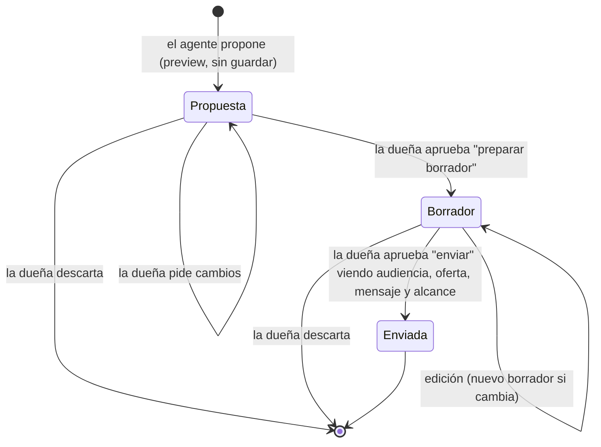

# PRD: Copiloto de negocio para Café Alborada

| Campo | Valor |
|---|---|
| Versión | 0.1 (borrador) |
| Fecha | 2026-11-04 |
| Autor | Oscar Monroy |
| Estado | En revisión |
| Fuente de requisitos | [`CONTEXTO_PRUEBA_TECNICA.md`](CONTEXTO_PRUEBA_TECNICA.md) |
| Documentos relacionados | [`02_CRITERIOS_ACEPTACION.md`](02_CRITERIOS_ACEPTACION.md) |

> Este documento define **qué** se construye y **por qué**. El **cómo** (stack, herramientas exactas del MCP, prompts) vive en los documentos de arquitectura, diseño del MCP y diseño del agente. Los IDs `R-`, `B-`, `X-`, `E-`, `D-`, `T-` vienen del archivo de contexto.

---

## 1. Resumen

Un copiloto conversacional para la dueña de Café Alborada. Ella pregunta en lenguaje natural cómo va su negocio y el copiloto responde con cifras verificables, gráficas, tablas y recomendaciones concretas. Cuando conviene, propone una campaña con audiencia, canal, oferta, mensaje y alcance real, y solo la crea y envía cuando ella la aprueba.

Se compone de tres piezas:

1. **Servidor MCP** que envuelve la API de Café Alborada con herramientas pensadas para un agente.
2. **Agente** que razona sobre los datos usando ese MCP, con un modelo elegido vía OpenRouter.
3. **Interfaz de chat** que muestra respuestas visuales elegidas por el agente.

---

## 2. Problema

- La dueña tiene datos de **lealtad** (visitas con tarjeta) y de **punto de venta** (tickets), pero **no tiene tiempo ni equipo** para analizarlos.
- Las preguntas que le importan cruzan fuentes: ventas, visitas, clientes, productos, sucursales y campañas pasadas.
- Lanzar una campaña hoy implica adivinar: no sabe a cuántas personas puede contactar de verdad, qué funcionó antes ni cuánto le cuesta la oferta.
- Un asistente que **invente** una cifra es peor que no tener asistente: la llevaría a decisiones malas con dinero real.

---

## 3. Usuarios

### 3.1 Usuaria principal: la dueña

| Rasgo | Implicación de diseño |
|---|---|
| No es analista; habla en términos de negocio ("¿cómo me fue?", "¿qué hago?") | El agente traduce preguntas vagas a periodos y métricas concretas, y dice cuáles eligió |
| Tiene poco tiempo | Respuesta corta primero, detalle después; una gráfica o tabla solo si aporta |
| Decide con dinero real | Toda cifra trae periodo y fuente; las recomendaciones incluyen costo y riesgo |
| Quiere control | Nada se crea ni se envía sin su aprobación explícita |
| Probablemente consulta desde el celular | La interfaz funciona bien en pantalla angosta |

### 3.2 Usuarios secundarios: evaluadores de Luyoa

Revisan la entrega, corren el proyecto, ven la demo y en la entrevista piden explicar y modificar el código. Necesitan: README de pocos pasos, trazas visibles, evaluaciones reproducibles y código claro.

---

## 4. Objetivos y no objetivos

### 4.1 Objetivos

| ID | Objetivo | Requisitos que atiende |
|---|---|---|
| O-01 | Responder con **cifras correctas** de la API, con periodo y fuente, y admitir lo que no sabe | R-02, R-03, B-06 |
| O-02 | Detectar **oportunidades** y explicar la evidencia | R-04, B-04, B-05 |
| O-03 | Proponer **campañas accionables** con alcance real por canal, costo de la oferta e impacto esperado | R-04, B-04, B-05, X-03 |
| O-04 | **Control humano** en todo lo que modifica datos: crear y enviar campañas | R-06 |
| O-05 | **Respuestas visuales** cuyo formato decide el agente | R-05 |
| O-06 | Un **MCP** con herramientas útiles para un agente y buen manejo de errores | R-01, B-07 |
| O-07 | **Elección de modelo medida**: calidad, costo y latencia | R-07, B-02 |
| O-08 | **Calidad demostrable**: evaluaciones automáticas y trazas | B-01, B-03 |
| O-09 | Entrega completa, segura y fácil de correr | R-08, R-09, D-01, D-02, D-03 |
| O-10 | Diferenciadores: demo publicada, resumen semanal, memoria, multi-negocio | X-01, X-02, X-04, X-05 |

### 4.2 No objetivos

- No se construye un BI genérico ni un constructor de dashboards.
- No se envían mensajes reales: el envío de la API es simulado.
- No se modifican datos de la API fuera del flujo de campañas (no hay endpoints de escritura para clientes, productos o tickets).
- No se entrena ni ajusta ningún modelo.
- No hay autenticación de usuarios final robusta más allá de lo necesario para proteger la demo publicada y separar negocios (X-05).

---

## 5. Métricas de éxito

Metas iniciales; se confirman o ajustan después de la exploración de la API y la comparación de modelos.

| ID | Métrica | Meta | Cómo se mide |
|---|---|---|---|
| M-01 | Exactitud de cifras en los seis escenarios | 100% de las cifras clave coinciden con las respuestas de referencia (tolerancia de redondeo) | Evaluación automática contra respuestas de referencia |
| M-02 | Cifras inventadas | 0 en el set de evaluación | Evaluación automática: toda cifra en la respuesta debe rastrearse a una salida de herramienta |
| M-03 | Envíos o borradores sin aprobación | 0 | Prueba automática del flujo + revisión de trazas |
| M-04 | Preguntas sin datos respondidas con honestidad | 100% de los casos negativos | Evaluación automática con casos fuera de alcance |
| M-05 | Formato visual adecuado | ≥ 90% de los casos usan el formato esperado (gráfica, tabla, tarjeta o texto) | Evaluación automática por caso |
| M-06 | Costo por conversación | Menos de USD 0.05 en promedio (a validar) | Registro de tokens y precio por modelo en las trazas |
| M-07 | Latencia | Primer texto visible en menos de 3 s; respuesta completa típica en menos de 20 s (a validar) | Trazas |
| M-08 | Llaves en el repositorio | 0, incluido el historial de git | Escáner de secretos en pre-commit y en CI |
| M-09 | Tiempo para correr el proyecto desde cero | Menos de 10 minutos siguiendo el README | Prueba en máquina limpia |

---

## 6. Alcance funcional

### 6.1 Servidor MCP (R-01, B-07)

- Expone herramientas a nivel de **tarea del agente**, no un espejo 1:1 de los endpoints. Ejemplos de capacidades (los nombres finales se definen en el diseño del MCP):
  - Contexto del negocio: fecha de corte, sucursales, reglas de puntos.
  - Comparar dos periodos de ventas.
  - Desglosar ventas o visitas por día de semana, hora, sucursal, categoría o producto, ya normalizadas cuando aplica (`transactions_per_day`).
  - Resumir la salud de cada sucursal.
  - Tamaño de segmentos y clientes en riesgo.
  - Alcance real de una audiencia en uno o varios canales.
  - Historial de campañas con resultados y lift contra grupo de control.
  - Costo y margen de una oferta a partir del catálogo.
  - Crear borrador y enviar campaña, cada una protegida por aprobación.
- Cada resultado trae **metadatos de procedencia**: endpoint, parámetros, periodo y fecha de corte, para que la interfaz pueda mostrar la fuente de cada cifra.
- Maneja paginación internamente; el agente no pagina.
- Respeta el límite de 120 solicitudes por minuto, reintenta `429` y `503` según `Retry-After` y devuelve errores claros y accionables para el agente (`401`, `404`, `409`, `422`).
- Valida antes de llamar: longitud de mensaje por canal, oferta posterior a `data_as_of`, tipo de oferta con sus campos.

### 6.2 Agente (R-02, R-03, R-04, R-06, B-04, B-05)

- Ancla todo periodo relativo a `data_as_of` (T-01) y lo dice en la respuesta.
- Usa la menor cantidad de llamadas y de contexto que resuelva la pregunta.
- Nunca afirma una cifra que no venga de una herramienta. Si no hay datos, lo dice y sugiere qué sí puede responder.
- Explica la evidencia de cada oportunidad: qué métrica, qué periodo, contra qué se compara.
- Al proponer campañas incluye: objetivo, audiencia, canal, oferta, mensaje, **alcance real** (`reachable` y exclusiones), costo estimado de la oferta, campañas parecidas y su resultado, impacto esperado y advertencias (muestra pequeña, sin grupo de control).
- Aprobación en dos momentos: antes de **crear** el borrador y antes de **enviarlo**. Una instrucción como "mándala" no cuenta como aprobación de un contenido que la dueña todavía no ha visto.
- Si una herramienta falla, reintenta lo razonable, explica qué pasó y ofrece una alternativa (B-07).

### 6.3 Interfaz de chat (R-05, B-03, B-06)

- Chat con historial de la conversación.
- Bloques visuales que el agente puede emitir:
  - **Gráfica** (barras, líneas) para comparaciones y tendencias.
  - **Tabla** para listados y desgloses.
  - **Indicadores** para cifras clave con variación.
  - **Tarjeta de campaña** con audiencia, canal, oferta, mensaje, alcance, costo e impacto, y botones de aprobación.
  - **Fuente**: referencia a los datos usados, con endpoint, parámetros y periodo.
- Panel de **trazas** por respuesta: qué herramientas usó el agente, con qué parámetros, por qué, cuánto tardó, tokens y costo.
- Estados claros: pensando, consultando datos, error con recuperación.

### 6.4 Elección de modelo (R-07, B-02)

- Varios modelos candidatos vía OpenRouter evaluados con el mismo set de casos.
- Se mide calidad (métricas M-01 a M-05), costo por conversación y latencia.
- Se documenta el modelo elegido, las alternativas probadas y por qué. Puede haber más de un modelo (por ejemplo, uno para orquestar y otro más barato para tareas simples) si los números lo justifican.

### 6.5 Calidad y observabilidad (B-01, B-03)

- Set de evaluación versionado con: los seis escenarios, el caso de ejemplo, casos negativos (sin datos, fuera de rango), casos de error de herramienta e intentos de saltarse la aprobación.
- Corredor de evaluaciones que se ejecuta con un comando y produce un reporte.
- Trazas persistentes por conversación.

### 6.6 Extras (X-01 a X-05)

| ID | Funcionalidad | Alcance mínimo |
|---|---|---|
| X-01 | Demo publicada | URL pública protegida contra abuso de las llaves (contraseña, límite de uso o ambos) |
| X-02 | Resumen semanal proactivo | Al abrir el chat, o con un botón, el agente genera un resumen de la última semana a `data_as_of` con 2 o 3 oportunidades |
| X-03 | Impacto esperado | Antes de enviar, estimar visitas y ventas adicionales usando el alcance y el lift de campañas parecidas, con rango e incertidumbre |
| X-04 | Memoria de preferencias | Guardar preferencias explícitas del negocio (canal preferido, tope de descuento, tono) y usarlas en siguientes conversaciones |
| X-05 | Varios negocios | Configuración por negocio (llave de API, memoria, campañas) aislada; el diseño lo soporta aunque la demo use uno |

---

## 7. Historias de usuario

| ID | Como dueña quiero… | Para… | Escenario | Requisitos |
|---|---|---|---|---|
| HU-01 | comparar un mes contra otro | saber si voy mejor o peor y por qué | E-01 | R-02, R-05 |
| HU-02 | saber mi peor día de la semana y qué hacer | llenar horas flojas | E-02 | R-02, R-04, B-04 |
| HU-03 | saber qué sucursal me debe preocupar | actuar a tiempo | E-03 | R-02, R-04 |
| HU-04 | saber qué clientes estoy perdiendo y a cuántos puedo contactar | recuperarlos | E-04 | R-02, R-04 |
| HU-05 | saber qué campañas me funcionaron y si repetiría alguna | no gastar en lo que no sirve | E-05 | R-02, B-05 |
| HU-06 | pedir que prepare y mande una campaña de recuperación | lanzar rápido sin perder el control | E-06 | R-04, R-06, X-03 |
| HU-07 | saber qué categoría me deja más utilidad y cómo empujarla | aumentar margen | Caso de ejemplo | R-02, R-04, B-04 |
| HU-08 | que me diga claramente cuando no tiene un dato | no decidir con cifras inventadas | Negativos | R-03 |
| HU-09 | ver de dónde sale cada cifra | confiar en la respuesta | Todos | B-06 |
| HU-10 | recibir un resumen semanal con oportunidades | no tener que preguntar | X-02 | X-02 |
| HU-11 | que recuerde mis preferencias | no repetirlas cada vez | X-04 | X-04 |
| HU-12 | entender qué pasó si algo falla | saber si puedo confiar en la respuesta | Errores | B-07 |

| ID | Como evaluador de Luyoa quiero… | Para… | Requisitos |
|---|---|---|---|
| HU-13 | correr todo con pocos pasos | revisar sin fricción | R-08, D-01 |
| HU-14 | ver qué herramientas usó el agente y por qué | juzgar su criterio | B-03 |
| HU-15 | correr las evaluaciones y la comparación de modelos | verificar la calidad | B-01, B-02 |
| HU-16 | abrir la demo sin instalar nada | probarla de inmediato | X-01 |

---

## 8. Requisitos funcionales

| ID | Requisito | Origen |
|---|---|---|
| RF-01 | El MCP expone herramientas orientadas a tareas, documentadas con descripción, parámetros y ejemplos | R-01 |
| RF-02 | Toda respuesta de herramienta con cifras incluye procedencia (endpoint, parámetros, periodo, `data_as_of`) | B-06 |
| RF-03 | El MCP pagina, reintenta `429`/`503` con `Retry-After` y traduce errores a mensajes accionables | R-01, B-07 |
| RF-04 | El MCP valida campos de campaña antes de llamar a la API | T-11 |
| RF-05 | El agente obtiene `data_as_of` antes de interpretar periodos relativos | T-01 |
| RF-06 | El agente compara días y horas por `transactions_per_day` | T-02 |
| RF-07 | El agente etiqueta como "antes de descuentos" la utilidad por categoría o producto | T-03 |
| RF-08 | El agente reporta alcance con `reachable` por canal y explica exclusiones | R-04, T-04 |
| RF-09 | El agente distingue datos de tarjeta (visitas) y de POS (tickets) | T-05 |
| RF-10 | El agente evalúa campañas pasadas por lift contra control cuando existe, y advierte cuando no | B-05, T-09 |
| RF-11 | El agente advierte muestras pequeñas | B-04, T-08 |
| RF-12 | El agente estima costo y margen de la oferta con precio y costo del catálogo | B-04, T-13 |
| RF-13 | El agente pide aprobación explícita antes de crear un borrador y antes de enviarlo | R-06, T-10 |
| RF-14 | El envío solo es posible después de que la interfaz mostró audiencia, oferta, mensaje y alcance | R-06 |
| RF-15 | Un borrador enviado no se puede reenviar; el `409` se explica a la dueña | T-12 |
| RF-16 | El agente elige el formato de respuesta (texto, gráfica, tabla, indicadores, tarjeta) | R-05 |
| RF-17 | La interfaz renderiza gráficas, tablas, indicadores, tarjetas de campaña y fuentes | R-05 |
| RF-18 | La interfaz muestra las trazas de cada respuesta | B-03 |
| RF-19 | Existe un set de evaluación y un comando que lo corre y reporta resultados | B-01 |
| RF-20 | Existe una comparación reproducible de modelos en calidad, costo y latencia | B-02 |
| RF-21 | El agente estima el impacto esperado antes de enviar | X-03 |
| RF-22 | El agente genera un resumen semanal con oportunidades | X-02 |
| RF-23 | El sistema guarda y usa preferencias del negocio entre conversaciones | X-04 |
| RF-24 | La configuración, memoria y datos de cada negocio están aislados | X-05 |
| RF-25 | La demo está publicada en una URL protegida | X-01 |
| RF-26 | Las cifras de ventas salen de analytics (que ya excluye reembolsos); si se usan tickets crudos, se excluyen los `refunded` | T-06 |
| RF-27 | Filtros de fecha en hora local y timestamps UTC convertidos a America/Mexico_City al mostrarse | T-07 |

## 9. Requisitos no funcionales

| ID | Requisito |
|---|---|
| RNF-01 | **Secretos:** llaves solo en variables de entorno; `.env` ignorado; `.env.example` sin valores; escáner de secretos en pre-commit |
| RNF-02 | **Confiabilidad:** ante fallos de la API el sistema no se cae ni inventa; responde con lo que sí obtuvo y lo dice |
| RNF-03 | **Contexto mínimo:** las herramientas devuelven datos agregados y recortados; nunca listados crudos grandes al modelo |
| RNF-04 | **Latencia:** respuestas en streaming; llamadas independientes en paralelo cuando el modelo lo permite |
| RNF-05 | **Costo:** registro de tokens y costo por conversación; tope de pasos por turno |
| RNF-06 | **Mantenibilidad:** código tipado, módulos pequeños, nombres claros; fácil de modificar en la entrevista |
| RNF-07 | **Portabilidad:** se corre con pocos comandos en Windows, macOS y Linux |
| RNF-08 | **Idioma:** la interfaz y las respuestas en español de México; montos en MXN |
| RNF-09 | **Responsivo:** la interfaz se usa bien en celular |
| RNF-10 | **Zona horaria:** fechas mostradas en America/Mexico_City |

---

## 10. Flujo de campaña con aprobación

Reglas:

- **Propuesta**: solo usa `preview`; no escribe nada.
- **Borrador**: se crea solo tras la primera aprobación.
- **Enviada**: se envía solo tras la segunda aprobación, con la tarjeta visible. Un borrador enviado no se reenvía.
- La aprobación la da la persona en la interfaz (botón o confirmación explícita), no el modelo.

---

## 11. Fuera de alcance y recortes posibles

Si el tiempo aprieta, se recorta en este orden (de lo primero que se sacrifica a lo último) y se documenta en el entregable D-03:

1. X-05 queda como diseño documentado, sin interfaz de cambio de negocio.
2. X-04 se limita a preferencias explícitas, sin aprendizaje implícito.
3. X-02 se ofrece con un botón en lugar de programarse.
4. Comparación de modelos con menos candidatos (mínimo 3).

Nunca se recorta: R-01 a R-09.

---

## 12. Supuestos, dependencias y riesgos

### 12.1 Supuestos

- "Octubre" y "septiembre" son meses calendario completos en hora local (Q-01).
- Hay dos aprobaciones: crear y enviar (Q-02).
- La API se mantiene disponible durante la semana de la prueba.

### 12.2 Dependencias

- Llave real de la API de Café Alborada y llave de OpenRouter (pendientes).
- Esquema `/openapi.json` para confirmar filtros y campos.

### 12.3 Riesgos

| ID | Riesgo | Impacto | Mitigación |
|---|---|---|---|
| RG-01 | El modelo inventa o redondea mal cifras | Alto (veracidad pesa 30) | Herramientas que devuelven cifras ya calculadas; regla de citar fuente; evaluación que rastrea cada cifra |
| RG-02 | Se agota el límite de gasto de OpenRouter durante evaluaciones | Medio | Correr evaluaciones con modelos baratos primero; caché de respuestas de la API; presupuesto por corrida |
| RG-03 | Rate limit de la API (120/min) durante evaluaciones o la demo | Medio | Caché, reintentos con `Retry-After`, herramientas que agregan en pocas llamadas |
| RG-04 | Demo pública expone las llaves a abuso | Alto | Llaves solo en servidor, contraseña o límite por IP, tope de pasos y de gasto |
| RG-05 | Ambigüedad en preguntas vagas ("¿cómo me fue?") | Medio | El agente elige un periodo razonable desde `data_as_of` y lo declara |
| RG-06 | El alcance crece y compromete lo requerido | Alto | Orden de recorte de la sección 11 |
| RG-07 | No poder explicar o modificar el código en la entrevista | Alto | Código simple, documentación de diseño, ensayo de cambios típicos |

---

## 13. Hitos (7 días)

| Día | Fecha | Hito |
|---|---|---|
| 1 | 2026-11-04 | Contexto, PRD, criterios de aceptación |
| 2 | 2026-11-05 | Exploración de API, respuestas de referencia, arquitectura, diseño de MCP, agente e interfaz, ADRs |
| 3 | 2026-11-06 | MCP funcionando con pruebas |
| 4 | 2026-11-07 | Agente + interfaz con bloques visuales y flujo de aprobación |
| 5 | 2026-11-08 | Evaluaciones, trazas, comparación de modelos |
| 6 | 2026-11-09 | Extras, demo publicada, endurecimiento |
| 7 | 2026-11-10 | README, documento de decisiones, grabación de demo; colchón para el 2026-11-11 |

---

## 14. Glosario

| Término | Significado |
|---|---|
| `data_as_of` | "Hoy" del dataset; base de toda ventana relativa |
| Alcance real / `reachable` | Clientes contactables en un canal después de excluir suspendidos, sin consentimiento y duplicados |
| Lift | Diferencia entre la tasa de visita del grupo tratado y la del grupo de control |
| Utilidad antes de descuentos | `gross_profit_before_discounts`: utilidad por categoría o producto sin restar descuentos, que se aplican al ticket completo |
| Borrador | Campaña creada en la API que todavía no se envía |
| MCP | Model Context Protocol: protocolo para exponer herramientas a un agente |
| Traza | Registro de los pasos del agente: herramientas, parámetros, tiempos, tokens y costo |
