# Arquitectura: Copiloto Café Alborada

| Campo | Valor |
|---|---|
| Versión | 0.1 (borrador) |
| Fecha | 2026-11-04 |
| Stack | TypeScript de punta a punta |
| Relacionados | [`01_PRD.md`](01_PRD.md), [`02_CRITERIOS_ACEPTACION.md`](02_CRITERIOS_ACEPTACION.md), [`04_DECISIONES_TECNICAS.md`](04_DECISIONES_TECNICAS.md) |

> Este documento describe **cómo** se construye y **cómo se comunican** las piezas. El detalle fino de cada herramienta del MCP, del prompt del agente y del contrato de bloques visuales vive en sus propios documentos (05, 06 y 07). Aquí se fija la forma general. Las decisiones con sus alternativas están en el registro de decisiones (`ADR-xx`).

---

## 1. Principios de diseño

Derivados del puntaje de Luyoa ("pequeña y confiable antes que grande y frágil"; veracidad = 30 puntos):

| # | Principio | Consecuencia concreta |
|---|---|---|
| P-1 | **Las cifras las calcula el código, no el modelo** | Las herramientas del MCP devuelven métricas ya calculadas (variaciones, normalizaciones, lift, costos). El modelo elige, interpreta y explica |
| P-2 | **Toda cifra tiene procedencia** | Cada resultado de herramienta lleva un `source` con id, endpoint, parámetros, periodo y `data_as_of`. Los bloques visuales citan esos ids |
| P-3 | **Escribir exige a una persona** | Crear y enviar campañas requiere aprobación en la interfaz y un token firmado por el servidor que el modelo no puede fabricar |
| P-4 | **Poco contexto** | Herramientas a nivel de tarea, respuestas compactas, nada de listados crudos. Paginación y agregación dentro del MCP |
| P-5 | **Fallar con claridad** | Reintentos automáticos cuando tiene sentido; si no, un error que el agente pueda explicar y del que se pueda recuperar |
| P-6 | **Todo se puede observar y medir** | Trazas por paso, costo por conversación y evaluaciones reproducibles desde el día uno |
| P-7 | **Simple de explicar y modificar** | Un solo lenguaje, pocos paquetes, módulos pequeños con nombres de negocio |

---

## 2. Vista de contexto (C4 nivel 1)

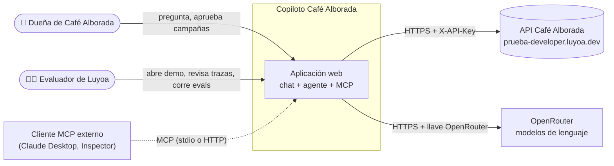

**Sistemas externos**

| Sistema | Uso | Restricciones |
|---|---|---|
| API Café Alborada | Única fuente de datos de negocio y de campañas | 120 req/min por llave; 429/503 con `Retry-After`; `limit` ≤ 100 |
| OpenRouter | Inferencia con el modelo elegido | Límite de gasto de la llave; costo por token según modelo |
| Cliente MCP externo | Demostrar que el MCP sirve a cualquier agente (CA-M08) | Opcional, solo para la demo técnica |

---

## 3. Vista de contenedores (C4 nivel 2)

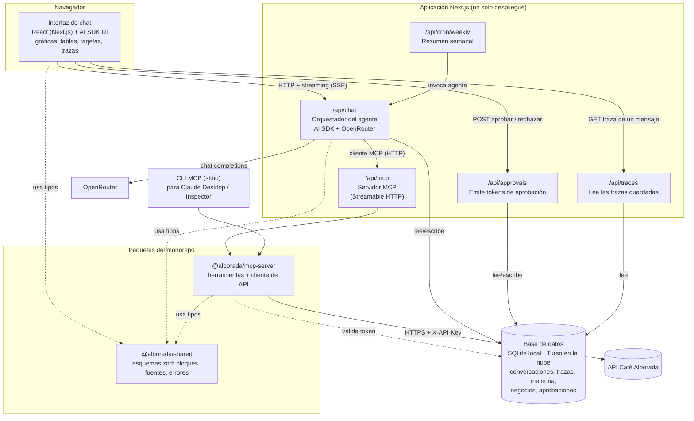

| Contenedor | Responsabilidad | Tecnología |
|---|---|---|
| Interfaz de chat | Mostrar conversación, bloques visuales, tarjetas con botones de aprobación y panel de trazas | Next.js (App Router), React, AI SDK UI (`useChat`), Recharts, Tailwind |
| Orquestador del agente (`/api/chat`) | Bucle del agente: prompt de sistema, memoria, herramientas del MCP, herramientas de presentación, streaming, registro de trazas y costo | AI SDK Core (`streamText`), proveedor de OpenRouter, cliente MCP del AI SDK |
| Aprobaciones (`/api/approvals`) | Registrar la decisión de la persona y emitir un token firmado de un solo uso, ligado al contenido exacto de la campaña | Route handler + HMAC |
| Trazas (`/api/traces`) | Entregar al panel de trazas los pasos guardados de un mensaje y el costo acumulado de su conversación, solo del mismo origen y del mismo negocio, con los tokens de aprobación enmascarados | Route handler + Drizzle |
| Servidor MCP (`/api/mcp` y CLI stdio) | Exponer las herramientas de negocio; mismo código para ambos transportes | SDK oficial de MCP para TypeScript, zod |
| `@alborada/mcp-server` | Herramientas, cliente HTTP de la API, caché, reintentos, validaciones, cálculo de métricas | TypeScript, `undici`/`fetch`, zod |
| `@alborada/shared` | Contratos compartidos: bloques visuales, `source`, errores, tipos de dominio | zod |
| Base de datos | Conversaciones, trazas, memoria de preferencias, negocios, aprobaciones, resúmenes | Drizzle ORM + libSQL (archivo local en desarrollo, Turso en la nube) |
| Resumen semanal (`/api/cron/weekly`) | Generar el resumen proactivo (X-02) | Vercel Cron o botón manual |

**¿Por qué el MCP vive dentro de la misma app y no como servicio aparte?** Un solo despliegue, una sola URL y cero infraestructura extra para la demo publicada (X-01). El núcleo del MCP es un paquete independiente con su propio CLI stdio, así que se puede sacar a otro servicio sin reescribir nada. Ver ADR-04.

---

## 4. Vista de componentes (C4 nivel 3)

### 4.1 Servidor MCP

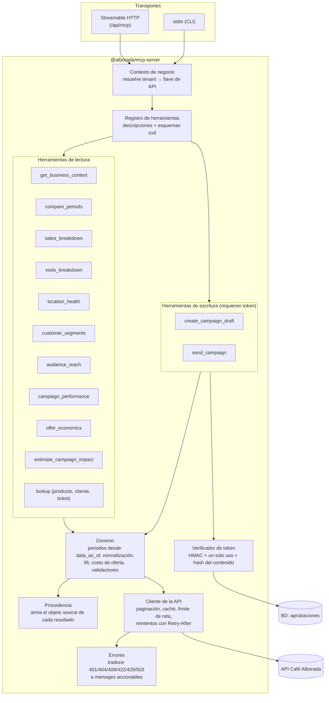

**Catálogo preliminar de herramientas** (el detalle va en `05_DISENO_MCP.md`):

| Herramienta | Qué resuelve | Endpoints que combina | Escenarios |
|---|---|---|---|
| `get_business_context` | Fecha de corte, rango de datos, sucursales, reglas de puntos, definiciones de segmentos | `/business`, `/locations`, `/segments` | Todos |
| `compare_periods` | KPIs de dos periodos con variación absoluta, porcentual y por día; desglose opcional por sucursal o categoría | `/analytics/sales`, `/analytics/visits` | E-01 |
| `sales_breakdown` | Ventas agrupadas por una dimensión, ordenadas, con la métrica correcta (`transactions_per_day`, utilidad antes de descuentos) y notas de interpretación | `/analytics/sales` | E-02, E-03, ejemplo |
| `visits_breakdown` | Igual, para visitas con tarjeta | `/analytics/visits` | E-02, E-03 |
| `location_health` | Tendencia por sucursal (ventana reciente contra anterior) en ventas, tickets, ticket promedio, visitas y participación de miembros, con alertas | `/analytics/sales`, `/analytics/visits` | E-03 |
| `customer_segments` | Tamaño de cada segmento, con filtro por sucursal de origen, y sus reglas | `/segments`, `/customers` | E-04 |
| `audience_reach` | Alcance real de una audiencia en uno o varios canales, con exclusiones | `/campaigns/preview` (una llamada por canal) | E-02, E-04, E-06, ejemplo |
| `campaign_performance` | Campañas pasadas con resultados, lift contra control, tamaño de muestra y alertas de confiabilidad | `/campaigns`, `/campaigns/{id}` | E-05, E-06 |
| `offer_economics` | Costo por redención y efecto en margen de una oferta, usando precio y costo del catálogo | `/products` | E-02, E-06, ejemplo |
| `estimate_campaign_impact` | Rango de visitas y ventas adicionales esperadas a partir del alcance y del lift de campañas parecidas | Usa los resultados de las anteriores | E-06 (X-03) |
| `lookup` | Detalle puntual de un producto, cliente o ticket | `/products`, `/customers/{id}`, `/transactions/{id}` | Preguntas puntuales |
| `create_campaign_draft` | Crea el borrador. **Exige token de aprobación** | `POST /campaigns` | E-06 |
| `send_campaign` | Envía el borrador. **Exige token de aprobación** | `POST /campaigns/{id}/send` | E-06 |

**Forma de toda respuesta de herramienta:**

```json
{
  "data": { "...": "métricas ya calculadas y compactas" },
  "notes": ["La utilidad por categoría es antes de descuentos."],
  "warnings": ["Solo 38 destinatarios: muestra pequeña."],
  "source": {
    "id": "src_7f3a",
    "tool": "sales_breakdown",
    "endpoints": ["GET /v1/analytics/sales?group_by=category&from=2026-08-01&to=2026-10-31"],
    "period": { "from": "2026-08-01", "to": "2026-10-31", "timezone": "America/Mexico_City" },
    "data_as_of": "2026-10-31",
    "fetched_at": "2026-11-06T17:02:11Z"
  }
}
```

Errores con la misma forma: `{ "error": { "code", "message", "retryable", "suggestion" } }`.

### 4.2 Orquestador del agente

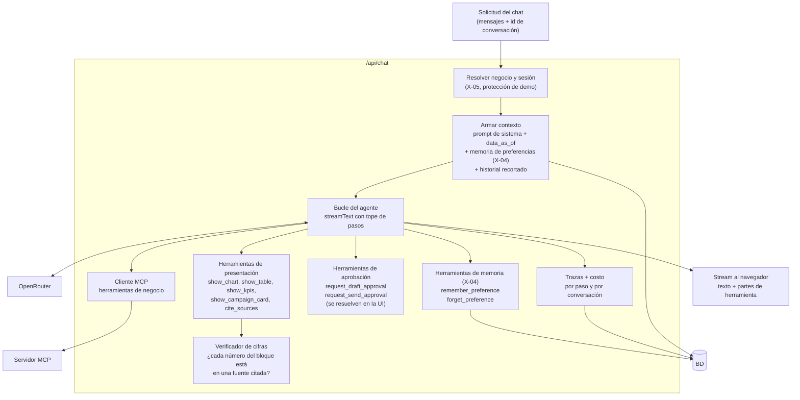

**Cómo elige el formato el agente (R-05):** los bloques visuales son **herramientas de presentación**. Cuando el modelo decide que una comparación se entiende mejor en gráfica, llama `show_chart` con datos y los `source.id` que la respaldan. La interfaz dibuja la parte de herramienta como un componente. Si no llama ninguna, la respuesta es solo texto. La decisión es del modelo, guiada por reglas en el prompt (gráfica para comparar, tabla para listar, tarjeta para campañas).

**Cliente MCP dentro del proceso:** el orquestador habla el protocolo MCP real, con Streamable HTTP y el token de servicio, contra el mismo manejador que atiende `/api/mcp`. Lo hace dentro del proceso: el `fetch` del cliente del AI SDK entrega cada solicitud al manejador sin pasar por la red. Así se evita un salto HTTP y no hace falta conocer la URL pública del despliegue. Los clientes externos, como el Inspector de MCP o Claude Desktop, usan el endpoint HTTP o stdio.

**Contexto y tope de pasos:** al inicio de cada turno el orquestador llama `get_business_context` por el MCP. Con su resultado arma el prompt de sistema: fecha de corte, calendario resuelto y sucursales. El bucle tiene un tope de 12 pasos; en el último se retiran las herramientas y se pide cerrar con lo obtenido. Hasta que existan las herramientas de aprobación (IMP-34), el agente solo ve las herramientas de lectura.

**Verificador de cifras (veracidad):** antes de emitir un bloque, el orquestador comprueba que cada número del bloque aparece en el resultado de alguna de las fuentes citadas (con tolerancia de redondeo). Si no, devuelve un error a la herramienta de presentación para que el modelo corrija. Lo mismo corre en las evaluaciones sobre el texto final (M-02).

Así se implementa (`apps/web/lib/agent/source-registry.ts` y `figure-verifier.ts`):

- **Registro de fuentes.** Cada turno arma un registro con dos orígenes: los resultados de herramientas que ya vienen en el historial y cada resultado nuevo del MCP. Para lo segundo, las herramientas de negocio se envuelven y registran su salida.
- **Coincidencia de cifras.** Una cifra del bloque coincide con una de la fuente si son iguales al redondear la de la fuente a los decimales mostrados. También se acepta una proporción mostrada como porcentaje (0.5569 como 55.7).
- **Alcance de la tarjeta.** La tarjeta de campaña debe repetir el alcance del último `audience_reach` citado para su canal.
- **Mensaje de la tarjeta.** El mensaje debe declarar su longitud real y respetar el límite del canal.
- **Si un bloque falla:** el modelo recibe la lista de problemas y la interfaz solo un aviso de corrección.
- **Alcance del verificador.** Revisa los bloques, no el texto libre. En la prueba de punta a punta del 2026-11-04 el modelo de desarrollo sumó cifras en el texto pese a la regla 1 del prompt. Eso lo mide la métrica de cifras sin fuente en las evaluaciones.

### 4.3 Interfaz

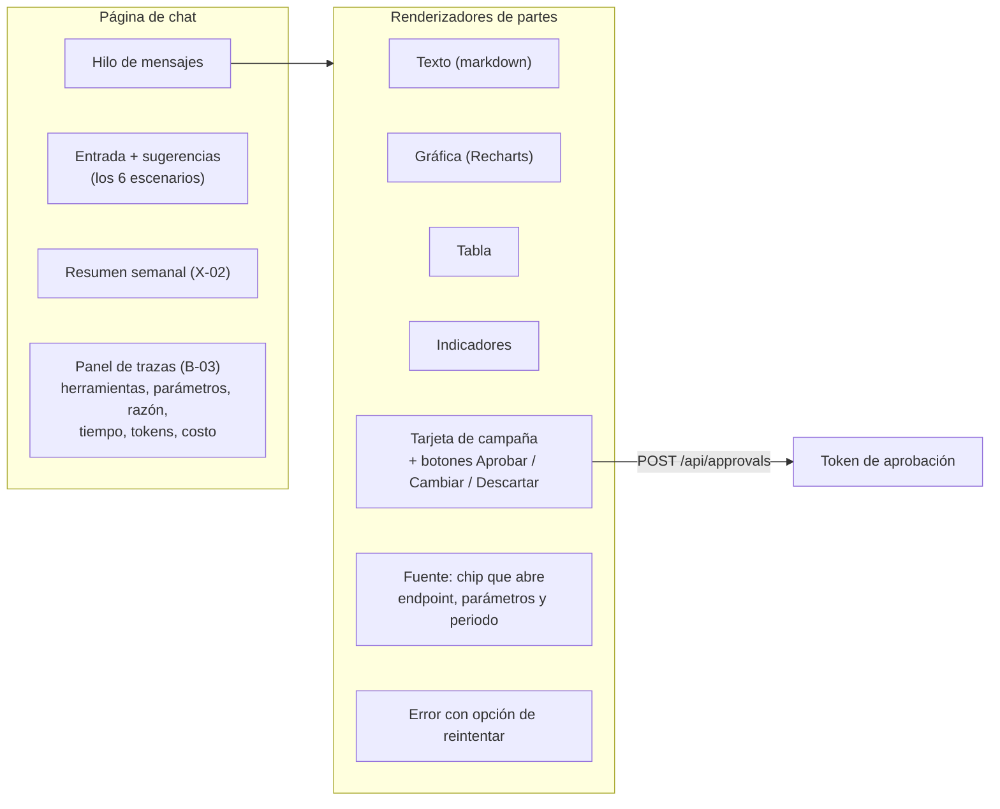

---

## 5. Flujos de comunicación

### 5.1 Pregunta analítica con propuesta (caso de ejemplo)

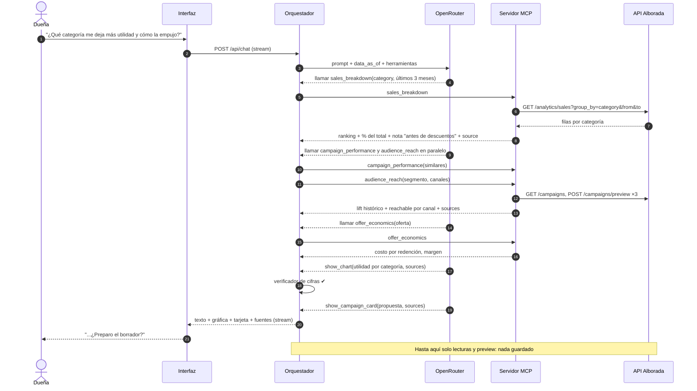

### 5.2 Campaña con doble aprobación (E-06)

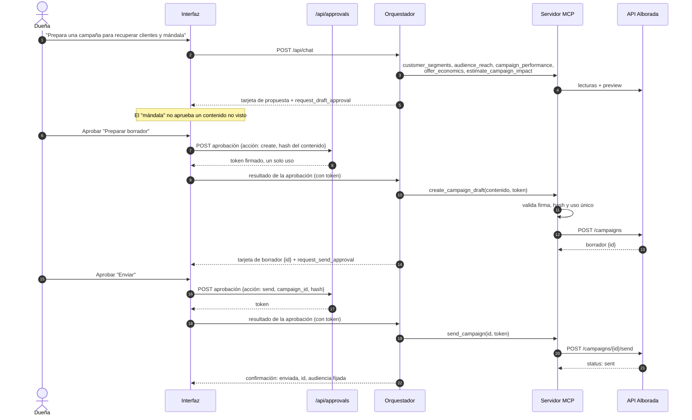

**Dos candados (P-3):**

1. **En el agente:** las acciones de escritura solo se piden mediante herramientas de aprobación que se resuelven en la interfaz, no en el servidor. El modelo no puede "auto-aprobar".
2. **En el MCP:** aunque alguien llame la herramienta directamente (por ejemplo desde Claude Desktop), sin un token válido emitido por `/api/approvals` la escritura se rechaza. El token está ligado al hash del contenido: si el modelo cambia una coma del mensaje después de aprobado, el token ya no sirve.

### 5.3 Ciclo de vida de una cifra (veracidad)

Cómo una cifra viaja de la API a la pantalla sin que el modelo la invente ni la recalcule:

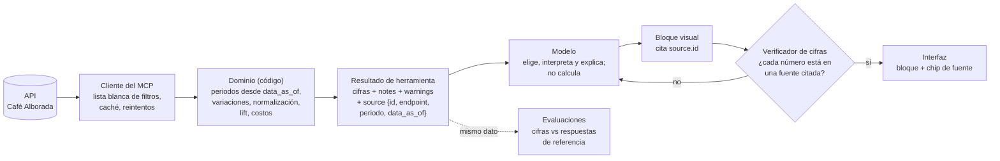

### 5.4 Fallo de herramienta y recuperación (B-07)

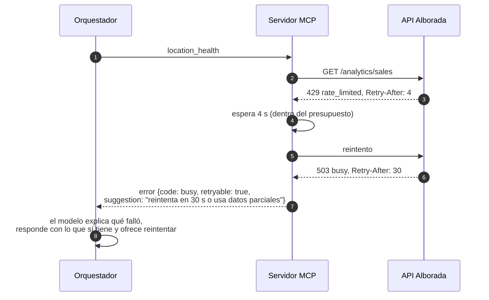

Reglas: reintento automático solo si `Retry-After` cabe en el presupuesto del turno (p. ej. ≤ 10 s); errores `422` regresan al modelo con el campo inválido para que corrija una vez; `401` corta y muestra un mensaje de configuración; nunca bucles de la misma llamada fallida.

---

## 6. Modelo de datos de la aplicación

La API de Café Alborada es la fuente de los datos de negocio. La base propia solo guarda lo que la API no tiene:

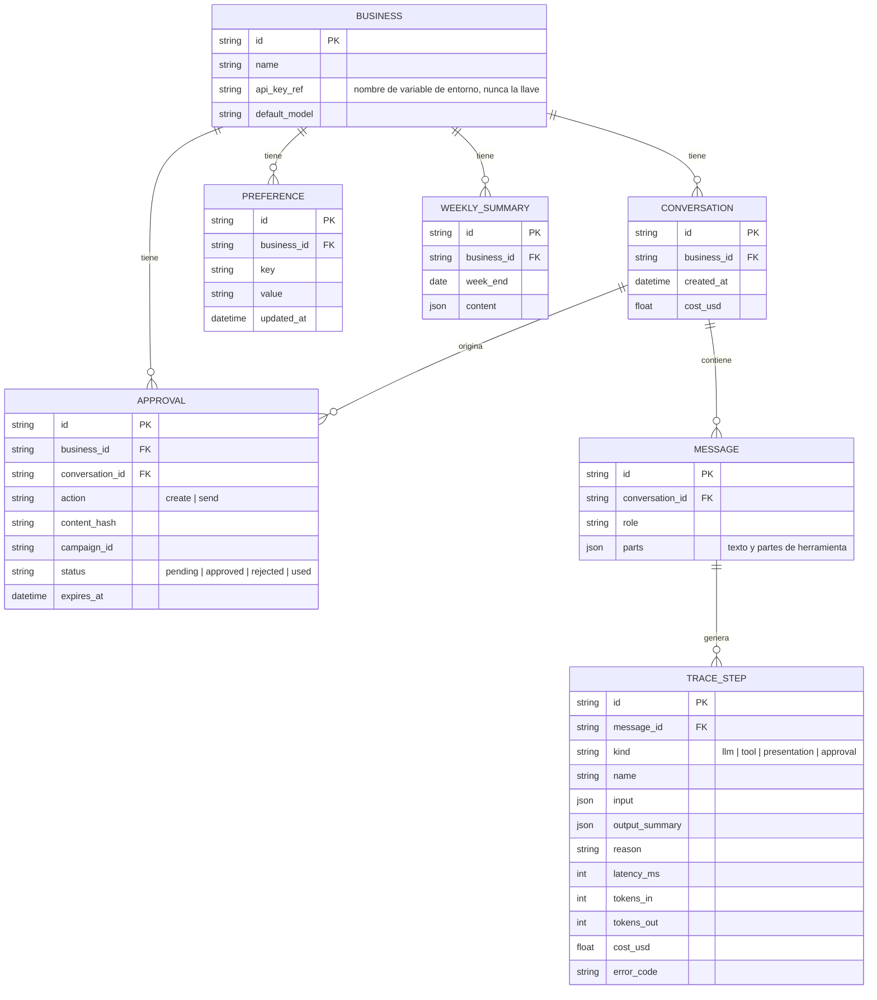

---

## 7. Despliegue

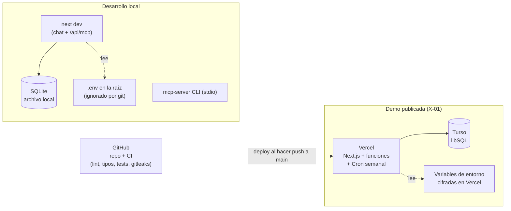

**Protección de la demo pública (RG-04, CA-S04):**

- Las llaves solo existen en el servidor; el navegador nunca las ve.
- Código de acceso para entrar a la demo, compartido con Luyoa. `proxy.ts` exige una sesión en cookie firmada (HMAC, 7 días, `HttpOnly`, `SameSite=Lax`) en todas las páginas y rutas de la interfaz; el código decide el negocio de la sesión (ADR-16).
- Límite de turnos por sesión e IP (IP cifrada con HMAC), tope de pasos por turno (12) y tope de gasto diario calculado con el costo de las trazas. Los contadores viven en la base porque en serverless la memoria no se comparte.
- El límite de gasto de la propia llave de OpenRouter es la última red.

---

## 8. Estructura del repositorio

```text
pt_luyoa/
├─ apps/
│  └─ web/                      Next.js: chat, /api/chat, /api/mcp, /api/approvals, /api/traces, /api/cron
│     ├─ app/
│     ├─ components/blocks/     chart, table, kpis, campaign-card, source, error
│     ├─ components/chat/       hilo, entrada, panel de trazas
│     ├─ lib/agent/             prompt, herramientas de presentación, verificador, trazas
│     ├─ lib/approvals/         emisión de tokens de aprobación
│     └─ lib/db/                esquema Drizzle y consultas
├─ packages/
│  ├─ mcp-server/               src/tools, src/domain, src/api, CLI stdio
│  └─ shared/                   esquemas zod compartidos
├─ evals/
│  ├─ cases/                    escenarios, ejemplo, negativos
│  ├─ golden/                   respuestas de referencia sacadas de la API
│  ├─ reports/                  reportes de evaluación y comparación de modelos
│  └─ src/                      golden, corredor y comparación
├─ scripts/quality/             arneses propios (comentarios bilingües)
├─ docs/                        especificaciones, estándares y gobernanza
├─ .claude/                     permisos, hooks, comandos y subagentes de Claude Code
├─ .githooks/                   commit-msg y pre-commit
├─ .github/                     CI, plantilla de PR, CODEOWNERS
├─ CLAUDE.md · AGENTS.md        contexto para agentes de IA
├─ .env.example                 variables sin valores
└─ README.md
```

---

## 9. Requisitos no funcionales: cómo se cumplen

| RNF | Mecanismo |
|---|---|
| RNF-01 Secretos | Variables de entorno; `.env*` en `.gitignore`; gitleaks en pre-commit y en CI; `api_key_ref` en BD guarda el nombre de la variable, no la llave |
| RNF-02 Confiabilidad | Reintentos con `Retry-After`, errores accionables, respuestas parciales declaradas |
| RNF-03 Contexto mínimo | Herramientas a nivel de tarea con salidas compactas; historial recortado; definiciones fijas en el prompt de sistema (se cachean) |
| RNF-04 Latencia | Streaming; llamadas paralelas de herramientas; caché en memoria de respuestas de la API por `(endpoint, params, data_as_of)` |
| RNF-05 Costo | Tokens y costo por paso desde el `usage` de OpenRouter; tope de pasos; modelo configurable por negocio |
| RNF-06 Mantenibilidad | TypeScript estricto, zod en las fronteras, módulos por herramienta, pruebas por herramienta |
| RNF-07 Portabilidad | Node LTS + pnpm; SQLite local sin instalar nada; un comando para levantar todo |
| RNF-08 Idioma | Prompt y UI en español de México; formateo con `Intl` en `es-MX` y MXN |
| RNF-09 Responsivo | Tailwind, diseño de una columna; panel de trazas plegable |
| RNF-10 Zona horaria | El dominio trabaja en fechas locales `America/Mexico_City`; conversión explícita de timestamps UTC |

---

## 10. Exploración de la API (resuelto)

La exploración del 2026-11-04 cerró los pendientes de esta sección. Resultados en [`05_DISENO_MCP.md`](05_DISENO_MCP.md) §1:

- `/customers` filtra con `segment` (no con `segment_id`, que se ignora en silencio); `/segments` ignora el filtro por sucursal, así que los conteos por sucursal salen de `/customers`.
- Campos de `results` en campañas confirmados; solo una de cuatro campañas históricas tiene grupo de control.
- Latencia observada de 170 ms a 1.8 s, sin cabeceras de límite de rata: caché y limitador propios.
- Queda por confirmar con `/openapi.json` (detrás de Cloudflare Access) la respuesta exacta de crear y enviar campañas.
