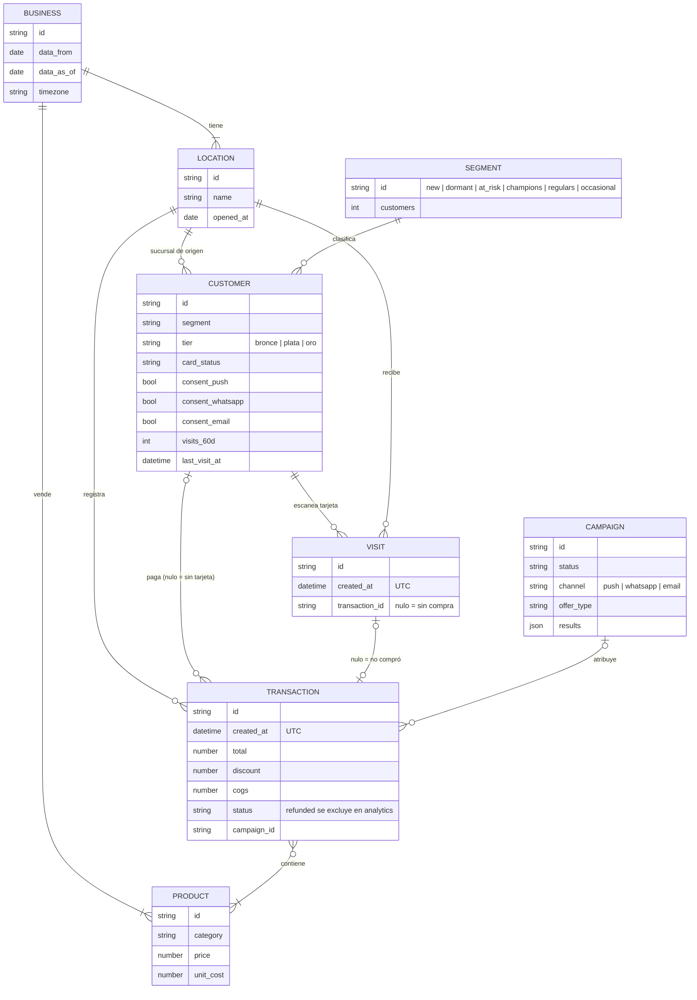
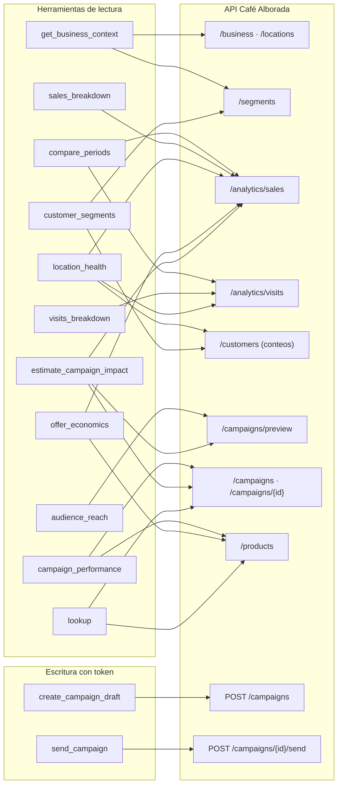
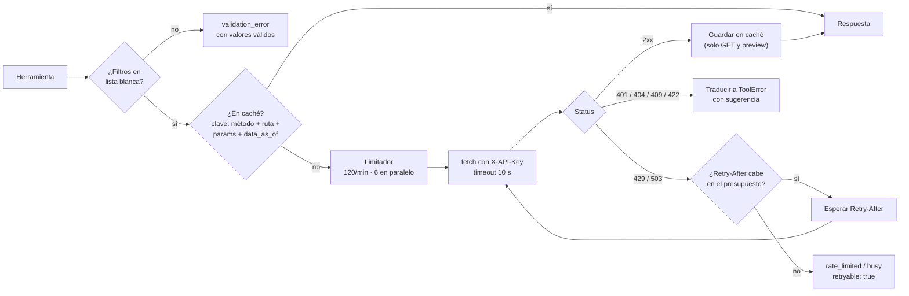
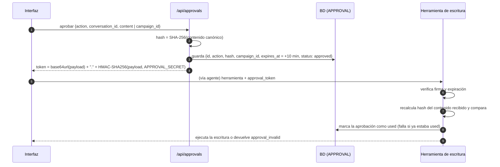

# Diseño del servidor MCP

| Campo | Valor |
|---|---|
| Versión | 1.0 |
| Fecha | 2026-11-04 |
| Responsable | Oscar Monroy |
| Relacionados | [`03_ARQUITECTURA.md`](03_ARQUITECTURA.md) §4.1, [`04_DECISIONES_TECNICAS.md`](04_DECISIONES_TECNICAS.md) ADR-04, ADR-05, ADR-08, ADR-09, [`06_DISENO_AGENTE.md`](06_DISENO_AGENTE.md) |

> Catálogo definitivo de herramientas, contratos y comportamiento del cliente de la API. Todo lo marcado como **verificado** se comprobó llamando la API real el 2026-11-04. Lo marcado como **por confirmar** depende del esquema `/openapi.json`, que está detrás de Cloudflare Access (inicio de sesión con correo) y aún no se descarga.

---

## 1. Hallazgos verificados de la API

### 1.1 Comportamiento general

| Tema | Hallazgo | Consecuencia para el MCP |
|---|---|---|
| Autenticación | `X-API-Key` en todos los endpoints de datos. `/docs` y `/openapi.json` redirigen a Cloudflare Access aunque se envíe la llave | El esquema se descarga a mano desde el navegador; el MCP no depende de él en tiempo de ejecución |
| Latencia | 170 ms a 1.8 s por llamada | Caché obligatoria; llamadas independientes en paralelo |
| Límite de rata | No se observaron cabeceras `X-RateLimit-*` | El MCP lleva su propio contador (120/min) y respeta `Retry-After` en 429/503 |
| Errores 422 | Código `invalid_request` con mensaje que lista los valores válidos (p. ej. `query.group_by: Input should be 'day', 'week', …`) | El mensaje se reenvía al agente como sugerencia; `invalid_request` se mapea a `validation_error` |
| Errores 404 | `{"error":{"code":"not_found","message":"Cliente no encontrado"}}` | Se traduce a `not_found` con el id buscado |
| Paginación | `limit` ≤ 100, `offset`, `pagination.total` | Para **contar** basta `limit=1` y leer `total` |

### 1.2 Filtros: lo que funciona y lo que se ignora

| Endpoint | Filtro | Resultado |
|---|---|---|
| `/v1/customers` | `segment=<id>` | ✅ Filtra (`at_risk` → 483) |
| `/v1/customers` | `segment_id=<id>` | ⚠️ **Se ignora en silencio** (devuelve los 2,030) |
| `/v1/customers` | `home_location_id`, `inactive_days_min`, `card_status` | ✅ Filtran |
| `/v1/customers` | `tier` | ✅ Valores válidos: `bronce`, `plata`, `oro` |
| `/v1/segments` | `home_location_id` | ⚠️ **Se ignora**: siempre devuelve el total del negocio |
| `/v1/analytics/sales` | `location_id`, `customer_type` (`member` \| `anonymous`), `from`, `to` | ✅ Filtran |
| `/v1/campaigns/preview` | `audience` con `segment_id`, `home_location_id`, `min_visits` combinados | ✅ Funciona (aquí sí es `segment_id`) |

**Regla de diseño derivada:** el MCP nunca pasa a la API un filtro que no esté en una lista blanca verificada por endpoint. Un filtro ignorado en silencio produce cifras falsas sin error visible (riesgo de veracidad).

### 1.3 Forma de las respuestas

| Endpoint | Campos relevantes |
|---|---|
| `/v1/business` | `id`, `name`, `timezone`, `currency`, `data_from`, `data_as_of`, `points_rule`, `reward_rule` |
| `/v1/locations` | `id`, `name`, `address`, `opened_at` |
| `/v1/products` | `id`, `name`, `category`, `price`, `unit_cost` |
| `/v1/segments` | `id`, `description`, `customers`, `avg_spend`, `total_spend`, `push_consent_rate`, `whatsapp_consent_rate`, `email_consent_rate` |
| `/v1/customers` | `id`, `card_number`, `first_name`, `last_name`, `phone`, `email`, `birth_date`, `signup_date`, `home_location_id`, `card_status`, `wallet_installed`, `consent_push`, `consent_whatsapp`, `consent_email`, `tier`, `points_balance`, `visits_count`, `visits_60d`, `last_visit_at`, `total_spend`, `avg_ticket`, `favorite_product_id`, `segment` |
| `/v1/visits` | `id`, `created_at`, `customer_id`, `location_id`, `transaction_id` |
| `/v1/transactions` | `id`, `created_at`, `location_id`, `customer_id`, `subtotal`, `discount`, `total`, `cogs`, `payment_method`, `status`, `points_earned`, `points_redeemed`, `campaign_id` |
| `/v1/analytics/sales` (general) | `key`, `label`\*, `transactions`, `net_sales`, `avg_ticket`, `discounts`, `gross_profit`, `member_share`, `active_days`, `transactions_per_day` |
| `/v1/analytics/sales` (`category`, `product`) | `key`, `label`, `units`, `transactions`, `gross_sales`, `gross_profit_before_discounts` |
| `/v1/analytics/visits` | `key`, `label`\*, `visits`, `unique_customers`, `purchase_rate`, `active_days`, `visits_per_day` |
| `/v1/campaigns` | `id`, `name`, `objective`, `status`, `channel`, `audience_description`, `audience_json`, `offer_type`, `offer_value`, `offer_product_id`, `valid_from`, `valid_to`, `message`, `created_at`, `sent_at`, `audience_size`, `simulated`, `results` |
| `results` | `targeted`, `control_size`, `sent`, `delivered`, `opened`, `redeemed`, `attributed_revenue`, `discount_cost`, `attributed_gross_profit`, `treatment_visit_rate`, `control_visit_rate` (nulo sin control) |
| `/v1/campaigns/preview` | `channel`, `matched`, `excluded_suspended`, `excluded_no_consent`, `excluded_duplicates`, `reachable` |

\* `label` **no viene** con `group_by` `month`, `day`, `week` ni `hour`: el MCP genera la etiqueta en español a partir de `key`.

**Datos personales:** `/v1/customers` devuelve nombre, teléfono, correo y fecha de nacimiento. El MCP **nunca** los incluye en salidas para el agente ([`data-and-secrets.md`](../governance/data-and-secrets.md) §3).

### 1.4 Por confirmar con `/openapi.json`

- Filtros de `/v1/visits` y `/v1/transactions` (no se usan en las herramientas iniciales).
- Respuesta exacta de `POST /v1/campaigns` y `POST /v1/campaigns/{id}/send` (códigos y campos).
- Si `/v1/campaigns` acepta filtros por estado o canal.

---

## 2. Modelo de dominio de la API



---

## 3. Principios de diseño de las herramientas

1. **Nivel de tarea, no de endpoint.** Una herramienta responde una pregunta de negocio completa; combina endpoints y calcula.
2. **Cifras calculadas en código** (ADR-09): variaciones, porcentajes, normalización por día, lift, costos y rangos de impacto.
3. **Salida compacta**: decenas de filas como máximo, sin datos personales, con `notes` y `warnings` en español.
4. **Procedencia siempre**: cada salida con cifras lleva `source` (tipo `Source` de `@alborada/shared`).
5. **Periodos por nombre o por fecha**: las herramientas aceptan `period` como preset (`last_full_month`, `previous_full_month`, `last_12_weeks`, `last_3_months`, `last_week`) o como `{ from, to }`. Los presets se resuelven desde `data_as_of`.
6. **Validación estricta** con zod y listas blancas de filtros; los errores dicen qué valor sí es válido.
7. **Descripciones para el agente**: qué responde, cuándo usarla, cuándo no, y un ejemplo.

---

## 4. Catálogo de herramientas

### 4.1 Resumen

| # | Herramienta | Tipo | Endpoints | Escenarios |
|---|---|---|---|---|
| 1 | `get_business_context` | Lectura | `/business`, `/locations`, `/segments` | Todos (se inyecta al inicio) |
| 2 | `compare_periods` | Lectura | `/analytics/sales`, `/analytics/visits` | E-01, resumen semanal |
| 3 | `sales_breakdown` | Lectura | `/analytics/sales` | E-02, E-03, ejemplo |
| 4 | `visits_breakdown` | Lectura | `/analytics/visits` | E-02, E-03 |
| 5 | `location_health` | Lectura | `/analytics/sales`, `/analytics/visits`, `/customers` (conteos) | E-03 |
| 6 | `customer_segments` | Lectura | `/segments`, `/customers` (conteos) | E-04, E-06 |
| 7 | `audience_reach` | Lectura | `/campaigns/preview` (una llamada por canal) | E-02, E-04, E-06, ejemplo |
| 8 | `campaign_performance` | Lectura | `/campaigns`, `/products` | E-05, E-06, ejemplo |
| 9 | `offer_economics` | Lectura | `/products`, `/analytics/sales` | E-02, E-06, ejemplo |
| 10 | `estimate_campaign_impact` | Lectura | `/campaigns/preview`, `/campaigns`, `/analytics/sales` | E-06 (X-03) |
| 11 | `lookup` | Lectura | `/products`, `/customers/{id}`, `/transactions/{id}`, `/campaigns/{id}` | Preguntas puntuales |
| 12 | `create_campaign_draft` | Escritura (token) | `POST /campaigns` | E-06 |
| 13 | `send_campaign` | Escritura (token) | `POST /campaigns/{id}/send` | E-06 |



### 4.2 Fichas

Formato de cada ficha: propósito, entrada, cálculo, salida, avisos y errores. Los tipos se escriben en notación TypeScript; en código son esquemas zod.

```ts
// Tipos comunes de entrada
type PeriodPreset = "last_full_month" | "previous_full_month" | "last_week" | "previous_week"
                  | "last_12_weeks" | "last_3_months" | "previous_3_months" | "all_data";
type PeriodInput = PeriodPreset | { from: string; to: string }; // fechas locales AAAA-MM-DD
type LocationId = "loc_coyoacan" | "loc_polanco" | "loc_roma"; // se valida contra /locations
type Channel = "push" | "whatsapp" | "email";
type SegmentId = "new" | "dormant" | "at_risk" | "champions" | "regulars" | "occasional";
type Audience = {
  segment_id?: SegmentId;
  home_location_id?: LocationId;
  tier?: "bronce" | "plata" | "oro";
  inactive_days_min?: number;
  min_visits?: number;
};
type Offer =
  | { type: "percent_off"; value: number; valid_from: string; valid_to: string }
  | { type: "points_multiplier"; value: number; valid_from: string; valid_to: string }
  | { type: "two_for_one"; product_id: string; valid_from: string; valid_to: string }
  | { type: "free_item"; product_id: string; valid_from: string; valid_to: string };
```

#### 1. `get_business_context`

- **Propósito:** contexto fijo de la conversación. El orquestador la llama al iniciar e inyecta el resultado en el prompt.
- **Entrada:** ninguna.
- **Salida:** nombre, `data_from`, `data_as_of`, zona horaria, moneda, reglas de puntos y recompensa, sucursales, segmentos con su definición y tamaño, y el **calendario resuelto** (fechas de cada preset y primer día válido para ofertas, `data_as_of + 1`).

#### 2. `compare_periods`

- **Propósito:** comparar dos periodos en ventas y visitas.
- **Entrada:** `{ current: PeriodInput; previous: PeriodInput; location_id?: LocationId; breakdown?: "location" | "category" | "none" }`.
- **Cálculo:** totales de cada periodo (`net_sales`, `transactions`, `avg_ticket`, `gross_profit`, `discounts`, visitas con tarjeta); variación absoluta y porcentual; **promedio por día** de cada métrica (los periodos pueden tener distinta duración); si hay `breakdown`, la misma comparación por grupo y el grupo que más explica la variación.
- **Salida:** `{ current, previous, delta, per_day, breakdown?, main_driver? }`.
- **Avisos:** "Los periodos tienen distinta duración (30 vs 31 días)"; "La utilidad por categoría es antes de descuentos".

#### 3. `sales_breakdown`

- **Propósito:** ventas agrupadas por una dimensión, con la métrica correcta.
- **Entrada:** `{ dimension: "weekday" | "hour" | "location" | "category" | "product" | "month" | "week" | "day"; period: PeriodInput; location_id?: LocationId; customer_type?: "member" | "anonymous"; sort_by?: string; top?: number }`.
- **Cálculo:** con `weekday`/`hour` ordena por `transactions_per_day`; con `category`/`product` usa `gross_profit_before_discounts` y calcula participación sobre el total; etiquetas en español cuando la API no las trae; marca el máximo y el mínimo.
- **Salida:** `{ rows, metric_used, highest, lowest, totals }`.
- **Avisos:** la métrica usada y por qué; "antes de descuentos" en categoría y producto.

#### 4. `visits_breakdown`

- **Propósito:** visitas con tarjeta agrupadas por una dimensión.
- **Entrada:** como `sales_breakdown`, sin `category`, `product` ni `customer_type`.
- **Cálculo:** con `weekday`/`hour` ordena por `visits_per_day`; incluye `purchase_rate`.
- **Avisos:** "Solo cuenta visitas con tarjeta de lealtad; no incluye ventas sin tarjeta".

#### 5. `location_health`

- **Propósito:** decidir qué sucursal preocupa, por tendencia y no por tamaño.
- **Entrada:** `{ recent?: PeriodInput; baseline?: PeriodInput }`. Por defecto, últimas 12 semanas contra las 12 anteriores, más la serie mensual de 12 meses.
- **Cálculo por sucursal:** variación de ventas netas, tickets, ticket promedio y visitas por día entre `recent` y `baseline`; pendiente de la serie mensual; clientes `at_risk` y `dormant` con esa sucursal de origen (conteos con `/customers?segment=…&home_location_id=…&limit=1`); nivel de preocupación con reglas explícitas (`domain/location-health.ts`): ventas netas ≤ −10% suma 1 punto (≤ −20% suma 2); tickets ≤ −10%, visitas por día ≤ −10% y promedio mensual de los últimos 3 meses ≤ −10% contra los 3 anteriores suman 1 punto cada uno. `alta` ≥ 3 puntos, `media` 1-2, `baja` 0; cada regla activada agrega su razón en texto.
- **Salida:** `{ recent_period, baseline_period, locations: [{ id, name, recent, baseline, change, quarter_trend, monthly_series, risk_customers, concern: { level, score, reasons } }], most_concerning }`, ordenada por puntaje.
- **Avisos:** "Una sucursal más pequeña no es preocupante por sí misma; se compara cada una contra su propio historial".

#### 6. `customer_segments`

- **Propósito:** tamaño y definición de los segmentos, opcionalmente por sucursal.
- **Entrada:** `{ segment_ids?: SegmentId[]; home_location_id?: LocationId }`.
- **Cálculo:** sin sucursal usa `/segments`; con sucursal cuenta con `/customers?segment=…&home_location_id=…&limit=1` porque `/segments` ignora ese filtro.
- **Salida:** `{ segments: [{ id, definition, customers, avg_spend?, consent_rates? }] }`.

#### 7. `audience_reach`

- **Propósito:** cuántas personas se pueden contactar de verdad.
- **Entrada:** `{ audience: Audience; channels?: Channel[] }` (por defecto los tres).
- **Cálculo:** un `preview` por canal en paralelo; ordena canales por `reachable`.
- **Salida:** `{ audience, by_channel: [{ channel, matched, reachable, excluded_no_consent, excluded_suspended, excluded_duplicates }], best_channel_by_reach }`.
- **Avisos:** "El alcance real ya descuenta tarjetas suspendidas, clientes sin consentimiento y duplicados".

#### 8. `campaign_performance`

- **Propósito:** qué campañas funcionaron y qué se puede aprender.
- **Entrada:** `{ channel?: Channel; offer_type?: Offer["type"]; similar_to?: { audience?: Audience; channel?: Channel; offer_type?: Offer["type"] } }`.
- **Cálculo por campaña:** tasa de canje (`redeemed / sent`), apertura (`opened / delivered`), **lift** (`treatment_visit_rate − control_visit_rate`, solo con control) con **intervalo de confianza del 95%** (diferencia de proporciones), costo por canje (`discount_cost / redeemed`) y `reliability`: `alta` (con control de 100 clientes o más), `media` (con control menor a 100), `baja` (sin control). Las campañas con lift medido se ordenan primero; las demás, por tasa de canje, que no mide efecto. Con `similar_to`, puntaje de similitud por canal, oferta y audiencia.
- **Salida:** `{ campaigns: [...], ranking_by: "lift" | "redemption_rate", learnings: string[] }`.
- **Avisos:** "Solo N de M campañas tienen grupo de control"; "Sin grupo de control no se puede atribuir la visita a la campaña".

#### 9. `offer_economics`

- **Propósito:** cuánto cuesta una oferta y qué hace con el margen.
- **Entrada:** `{ offer: Offer; expected_redemptions?: number }`.
- **Cálculo:** `free_item` → costo = `unit_cost` del producto; `two_for_one` → costo = `unit_cost` del segundo producto; `percent_off` → costo = `value`% del ticket promedio de los últimos 3 meses; `points_multiplier` → puntos extra por ticket promedio valuados hasta $0.45 por punto (bebida de $68 por 150 puntos), costo diferido hasta el canje. Utilidad promedio de una visita = ticket promedio × margen bruto (últimos 3 meses). Con `expected_redemptions`, costo total.
- **Salida:** `{ cost_per_redemption, visit_gross_profit, margin_after_offer, total_cost_scenarios, assumptions }`.
- **Avisos:** "Supuesto: …" por cada supuesto del cálculo.

#### 10. `estimate_campaign_impact` (X-03)

- **Propósito:** impacto esperado antes de enviar.
- **Entrada:** `{ audience: Audience; channel: Channel; offer: Offer }`.
- **Cálculo:** campaña de referencia = la más parecida (mismo canal y/o tipo de oferta) que tuvo grupo de control. Visitas extra = `reachable` × intervalo de confianza del 95% de su lift; ventas extra = visitas × ticket promedio; canjes = `reachable` × tasa de canje de las campañas parecidas (mín., promedio, máx.); costo de oferta = canjes × costo por canje; utilidad neta **conservadora** (escenario bajo = menor utilidad extra con mayor costo). Sin referencia con control devuelve solo canjes (`kind: redemptions_only`) y lo advierte; con una sola campaña parecida advierte que los canjes no tienen rango. Siempre **rango** (bajo, central, alto).
- **Salida:** `{ extra_visits: [low, mid, high], extra_net_sales: [...], offer_cost: [...], net_gross_profit: [...], basis, confidence }`.
- **Avisos:** la campaña de referencia y su confiabilidad.

#### 11. `lookup`

- **Propósito:** detalle puntual sin datos personales.
- **Entrada:** `{ kind: "product" | "customer" | "campaign"; id: string }`. El detalle de ticket queda fuera hasta verificar su esquema contra la API.
- **Salida:** producto completo; cliente **solo** con id, segmento, tier, sucursal, visitas, gasto, último día de visita y consentimientos (sin nombre, teléfono, correo ni fecha de nacimiento); campaña con resultados y métricas.

#### 12. `create_campaign_draft`

- **Entrada:** `{ campaign: { name; objective; channel; audience; offer; message }; approval_token: string }`.
- **Validación previa:** longitud del mensaje por canal (140 / 1024 / 5000); `valid_from > data_as_of`; `valid_to ≥ valid_from`; campos de la oferta según su tipo; productos existentes.
- **Token:** acción `create`, hash del contenido idéntico al aprobado (ver §6).
- **Salida:** `{ campaign_id, status: "draft", audience, reach }` y `source`.

#### 13. `send_campaign`

- **Entrada:** `{ campaign_id: string; approval_token: string }`.
- **Token:** acción `send`, mismo `campaign_id` y hash del borrador.
- **Errores:** `409` → "Este borrador ya se envió" con su estado actual.
- **Salida:** `{ campaign_id, status: "sent", sent_at, audience_size }`.

---

## 5. Cliente de la API



| Aspecto | Decisión |
|---|---|
| Caché | En memoria, por proceso. Clave: método, ruta, parámetros ordenados y `data_as_of`. Sin expiración durante la sesión (el dataset es estático); se vacía al reiniciar |
| Concurrencia | Máximo 6 solicitudes simultáneas y 120 por minuto (ventana deslizante) |
| Reintentos | Solo 429 y 503; hasta 2 reintentos; presupuesto total de espera 10 s por llamada de herramienta |
| Timeout | 10 s por solicitud |
| Paginación | Interna: el cliente recorre `offset` cuando la herramienta necesita el listado completo; para conteos usa `limit=1` |
| Registros | Ruta, status y duración a `stderr`; nunca la llave ni datos personales |

---

## 6. Tokens de aprobación



| Campo del payload | Uso |
|---|---|
| `aid` | Id de la aprobación (uso único) |
| `act` | `create` o `send` |
| `biz` | Negocio (aislamiento X-05) |
| `cid` | Id de campaña (solo `send`) |
| `h` | Hash SHA-256 del contenido canónico (JSON con llaves ordenadas) |
| `exp` | Expiración (10 minutos) |

---

## 7. Errores que ve el agente

| Código | Origen | `retryable` | Sugerencia típica |
|---|---|---|---|
| `validation_error` | Validación previa o 422 `invalid_request` | No | "Valores válidos para `tier`: bronce, plata, oro" |
| `not_found` | 404 | No | "No existe el cliente `cus_x`; usa un id de la lista" |
| `conflict` | 409 | No | "La campaña ya se envió" |
| `rate_limited` | 429 tras reintentos | Sí | "Reintenta en N s" |
| `busy` | 503 tras reintentos | Sí | "Servicio saturado; reintenta en N s o responde con lo obtenido" |
| `unauthorized` | 401 | No | "Revisa la configuración de la llave" (sin mostrarla) |
| `approval_required` | Escritura sin token | No | "Pide aprobación con request_draft_approval" |
| `approval_invalid` | Token vencido, usado o con otro contenido | No | "Vuelve a pedir aprobación" |
| `upstream_error` | Cualquier otro | Sí | "Error inesperado de la API" |

---

## 8. Transporte y autenticación del MCP

| Transporte | Uso | Autenticación |
|---|---|---|
| stdio (`pnpm mcp:stdio`) | Claude Desktop, Inspector de MCP | Proceso local con el `.env` del desarrollador |
| Streamable HTTP (`/api/mcp`) | El agente de la app | `Authorization: Bearer <MCP_SERVICE_TOKEN>`; el token identifica al negocio (X-05) |

---

## 9. Pruebas

| Nivel | Qué cubre |
|---|---|
| Dominio | Presets de periodo desde `data_as_of`, normalización por día, variaciones, lift y confiabilidad, costo de oferta, rangos de impacto, etiquetas en español |
| Cliente | Lista blanca de filtros, caché, reintentos con `Retry-After`, mapeo de errores, paginación |
| Herramientas | Cada herramienta contra respuestas grabadas de la API (sin red), incluida la ausencia de datos personales en la salida |
| Tokens | Firma inválida, token vencido, reutilizado, contenido alterado, acción equivocada |
| Integración | Las herramientas contra la API real (`pnpm test:integration`) |
