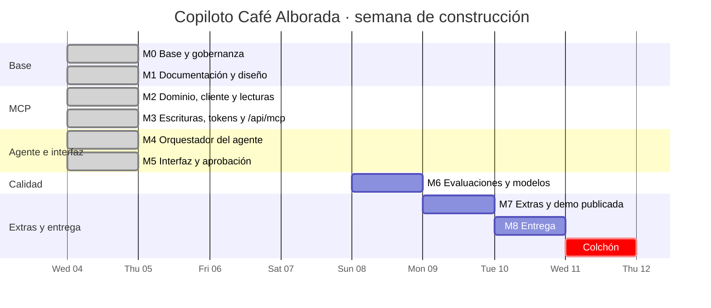
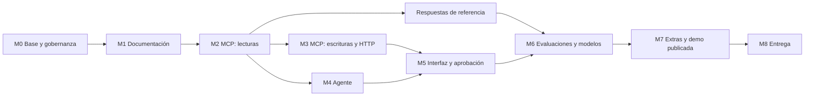
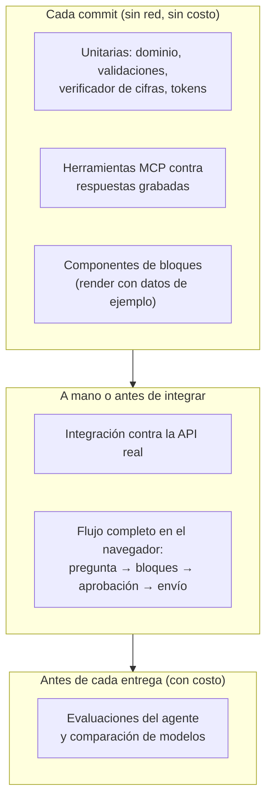

# Plan de implementación

| Campo | Valor |
|---|---|
| Versión | 1.0 |
| Fecha | 2026-11-04 |
| Responsable | Oscar Monroy |
| Entrega | A más tardar 2026-11-11 |
| Relacionados | [`01_PRD.md`](01_PRD.md) §11 y §13, [`02_CRITERIOS_ACEPTACION.md`](02_CRITERIOS_ACEPTACION.md), [`05_DISENO_MCP.md`](05_DISENO_MCP.md), [`08_PLAN_EVALUACION.md`](08_PLAN_EVALUACION.md) |

> Orden de construcción, tareas con su criterio de aceptación y la estrategia de pruebas. Al iniciar cada hito se decide si se trabaja en `main` o en la rama sugerida (ver `docs/standards/git-workflow.md` §3). Todo hito termina con `pnpm verify` en verde.

---

## 1. Cronograma

## 2. Dependencias entre hitos

---

## 3. Hitos y tareas

Cada tarea tiene un ID `IMP-xx`, la rama donde se hace y el criterio que la da por terminada.

### M0 · Base y gobernanza (hecho)

Monorepo, arneses, CI, documentación de estándares y gobernanza. PR [omonroyt/pt_luyoa#1](https://github.com/omonroyt/pt_luyoa/pull/1).

### M1 · Documentación y diseño (hecho, PR #2)

| ID | Tarea | Criterio |
|---|---|---|
| IMP-01 | Explorar la API y documentar hallazgos | `05_DISENO_MCP.md` §1 |
| IMP-02 | Catálogo final de herramientas MCP | `05_DISENO_MCP.md` §4 |
| IMP-03 | Plan de implementación y estrategia de pruebas | Este documento |
| IMP-04 | Descargar `/openapi.json` desde el navegador y confirmar lo pendiente | `05_DISENO_MCP.md` §1.4 cerrado |

### M2 · MCP: dominio, cliente y lecturas (hecho, rama `feat/mcp-lecturas`)

| ID | Tarea | Criterio |
|---|---|---|
| IMP-10 | Cliente de la API: lista blanca de filtros, caché, limitador, reintentos, mapeo de errores | CA-M05, CA-M06, CA-N06, CA-N07 |
| IMP-11 | Dominio: presets de periodo desde `data_as_of`, normalización, variaciones, etiquetas | CA-V03, CA-V05, CA-V06, CA-V11 |
| IMP-12 | Grabador de respuestas (fixtures) que elimina datos personales | CA-S01, [`data-and-secrets.md`](../governance/data-and-secrets.md) |
| IMP-13 | `get_business_context`, `compare_periods`, `sales_breakdown`, `visits_breakdown` | CA-E01-1 a 3, CA-E02-2, CA-M04 |
| IMP-14 | `location_health`, `customer_segments`, `audience_reach` | CA-E03-1, CA-E04-1 a 3, CA-C06 |
| IMP-15 | `campaign_performance`, `offer_economics`, `estimate_campaign_impact`, `lookup` | CA-E05-1 a 4, CA-C07, CA-X03 |
| IMP-16 | Script de respuestas de referencia (`pnpm golden`) | `08_PLAN_EVALUACION.md` §2 |
| IMP-17 | MCP por stdio probado contra la API real (`smoke`) y compatible con el Inspector de MCP | CA-M08 |

### M3 · MCP: escrituras, tokens y HTTP (hecho, rama `feat/mcp-escrituras`)

| ID | Tarea | Criterio |
|---|---|---|
| IMP-20 | Base de datos (Drizzle + libSQL): negocios, conversaciones, mensajes, trazas, preferencias, aprobaciones | ADR-10 |
| IMP-21 | Tokens de aprobación: emisión en `/api/approvals` y verificación en el MCP | CA-C02, CA-C03, CA-M07 |
| IMP-22 | `create_campaign_draft` y `send_campaign` con validaciones previas | CA-C08, CA-C09, CA-C10 |
| IMP-23 | Endpoint `/api/mcp` (Streamable HTTP) con token de servicio por negocio | ADR-04, CA-X05 |

### M4 · Orquestador del agente (hecho, rama `feat/agente`)

| ID | Tarea | Criterio |
|---|---|---|
| IMP-30 | `/api/chat` con AI SDK, OpenRouter y cliente MCP; tope de pasos | ADR-06, RNF-05 |
| IMP-31 | Prompt de sistema con contexto del negocio y calendario resuelto | `06_DISENO_AGENTE.md` §2 y §3 |
| IMP-32 | Herramientas de presentación con esquemas de `@alborada/shared` | CA-F01 a CA-F05 |
| IMP-33 | Verificador de cifras | CA-V01, ADR-09 |
| IMP-34 | Herramientas de aprobación (`request_draft_approval`, `request_send_approval`) | CA-C02 a CA-C05 |
| IMP-35 | Trazas por paso con razón, latencia, tokens y costo | CA-Q05, CA-Q06 |

### M5 · Interfaz y aprobación (hecho, rama `feat/interfaz`)

| ID | Tarea | Criterio |
|---|---|---|
| IMP-40 | Chat con streaming y sugerencias de los seis escenarios | `07_RESPUESTAS_VISUALES.md` §4 |
| IMP-41 | Bloques: gráfica, tabla, indicadores, fuente, error | CA-F06, CA-R01, CA-R02 |
| IMP-42 | Tarjeta de campaña con estados y botones de aprobación | CA-C03, CA-E06-2 |
| IMP-43 | Panel de trazas | CA-Q05 |
| IMP-44 | Responsivo y accesible | CA-F07 |

### M6 · Evaluaciones y modelos (hecho, rama `feat/evaluaciones`)

| ID | Tarea | Criterio |
|---|---|---|
| IMP-50 | Casos de evaluación (36) en `evals/cases/` | CA-Q01 |
| IMP-51 | Corredor con verificaciones deterministas, juez con rúbrica y puertas duras | CA-Q02 |
| IMP-52 | Comparación de al menos 4 modelos y reporte | CA-Q03, ADR-13 |
| IMP-53 | Ajustes de prompt y herramientas hasta cumplir las metas | `08_PLAN_EVALUACION.md` §4.4 |

**Resultado:**
- La comparación midió 5 modelos en el humo y a GLM-5.3-Flash y Claude Haiku 5.5 en la corrida completa (34 casos × 2). El modelo final es `anthropic/claude-haiku-5.5` (ADR-13).
- Los ajustes de IMP-53 salen de las transcripciones de Haiku:
  - tarjeta con solo el texto del mensaje;
  - una compuerta de tarjeta que solo acepta la aprobación después de una tarjeta verificada, y la tarjeta del borrador obligatoria;
  - total de clientes en riesgo por sucursal;
  - reglas de cifras exactas en el prompt.
- **Corrida completa final** (`2026-11-05-compare-completa-claude-haiku-5.5`, 34 casos × 1): cumple todas las metas de §4.4.
  - 0.97 ± 0.04 de puntaje medio;
  - 100% de exactitud en escenarios, 0 cifras sin fuente y 0 violaciones de control;
  - 100% de negativos honestos;
  - 0.0112 USD por conversación y 11.1 s de mediana.
- La segunda repetición no se corrió por el tope de gasto de la corrida.

### M7 · Extras y demo publicada — rama sugerida `feat/extras`

| ID | Tarea | Criterio |
|---|---|---|
| IMP-60 | Resumen semanal proactivo | CA-X02 |
| IMP-61 | Memoria de preferencias (hecho) | CA-X04 |
| IMP-62 | Aislamiento de dos negocios probado | CA-X05 |
| IMP-63 | Despliegue en Vercel + Turso con código de acceso y topes | CA-X01, CA-S04 |

### M8 · Entrega — rama sugerida `docs/entrega`

| ID | Tarea | Criterio |
|---|---|---|
| IMP-70 | README final | CA-D01 |
| IMP-71 | Documento de decisiones (arquitectura, modelo, costo por conversación, trabajo futuro, recortes) | CA-D03 |
| IMP-72 | Guion y grabación de la demo | CA-D02 |
| IMP-73 | Revisión final con los subagentes y la lista de entrega | Sección 6 |

---

## 4. Estrategia de pruebas

| Nivel | Herramienta | Dónde | Meta |
|---|---|---|---|
| Unitarias | Vitest | `*.test.ts` junto al código | Toda función de dominio cubierta; casos borde (cero días, periodos de distinta duración, sin grupo de control) |
| Herramientas MCP | Vitest + fixtures | `packages/mcp-server/src/tools/*.test.ts` | Cada herramienta: salida correcta, `source` presente, sin datos personales, errores mapeados |
| Componentes | Vitest + Testing Library | `apps/web/components/**/*.test.tsx` | Cada bloque se dibuja con su esquema y muestra unidades y periodo |
| Integración | Vitest con red | `pnpm test:integration` | Las herramientas contra la API real |
| Extremo a extremo | Navegador | Manual, guiado por los seis escenarios | Los seis escenarios y el flujo de aprobación |
| Agente | Corredor propio | `pnpm eval` | Metas de `08_PLAN_EVALUACION.md` §4.4 |

**Fixtures:** se graban de la API real con un script que elimina `first_name`, `last_name`, `phone`, `email`, `birth_date` y `card_number` antes de guardar. Ninguna fixture contiene datos personales ni la llave.

---

## 5. Flujo de trabajo por hito

1. Al iniciar, decidir con el desarrollador si el hito va en `main` o en su rama sugerida, creada desde `main` actualizado.
2. Implementación en pasos pequeños; commits convencionales y atómicos, a nombre del desarrollador.
3. `pnpm verify` en verde y revisión con `/review`.
4. Si hay rama de feature: pull request con la plantilla, CI en verde e integración a `main`.

## 6. Lista de entrega

- [ ] R-01 a R-09 cumplidos y verificados (`02_CRITERIOS_ACEPTACION.md` §8).
- [ ] Seis escenarios con cifras iguales a las respuestas de referencia.
- [ ] Evaluaciones y comparación de modelos con reporte versionado.
- [ ] Demo publicada protegida; llaves solo en el servidor.
- [ ] README probado desde un clon limpio en menos de 10 minutos.
- [ ] Documento de decisiones y video de 5 minutos o menos.
- [ ] Historial sin llaves (gitleaks en CI) y sin atribución a IA.

## 7. Guion de la demo (estructura)

| Tramo | Duración | Contenido |
|---|---|---|
| Apertura | 0:20 | Qué es, para quién y cómo está armado (diagrama de contenedores) |
| E-01 | 0:35 | Octubre vs septiembre: indicadores, gráfica, aviso de días distintos, fuente |
| E-02 | 0:40 | Peor día: gráfica por día, campaña propuesta con alcance real y costo, aprendizaje de campañas pasadas |
| E-03 | 0:35 | Sucursal preocupante: tendencia por sucursal y evidencia |
| E-04 | 0:30 | Clientes que se pierden: tabla de alcance por canal |
| E-05 | 0:35 | Campañas que funcionaron: lift, confiabilidad, qué repetiría |
| E-06 | 0:55 | Campaña de recuperación: propuesta → aprobación → borrador → aprobación → envío |
| Cierre | 0:30 | Panel de trazas, reporte de evaluaciones, elección de modelo y costo por conversación |
