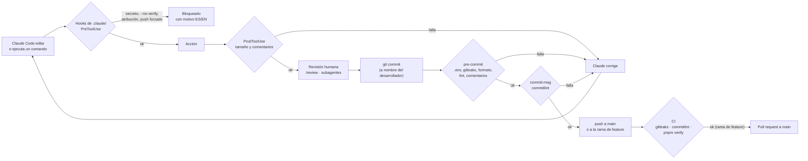

# Flujo de git, Conventional Commits y autoría

| Campo | Valor |
|---|---|
| Versión | 1.0 |
| Fecha | 2026-11-04 |
| Responsable | Oscar Monroy |

---

## 1. Política de autoría (no negociable)

El desarrollador responsable, **Oscar Monroy**, es el único autor de todo el trabajo de este repositorio y responde por cada decisión y cada cambio. Las herramientas de IA son herramientas: no son autoras ni coautoras.

| Regla | Lo verifica |
|---|---|
| Todo commit se hace con la identidad de git configurada del desarrollador | Revisión + hook de Claude Code (bloquea cambios a `user.name`/`user.email` y `--author`) |
| Ningún commit, PR, tag o release contiene `Co-Authored-By`, `Signed-off-by` de una IA, "Generated with…", "Generado con…" ni menciones a Claude, Anthropic u otras herramientas de IA | `commitlint` (regla `no-ai-attribution`), hook de Claude Code, `.claude/settings.json` (`attribution` vacío) |
| Los asistentes de IA solo hacen commit o push cuando el desarrollador lo pide explícitamente | `CLAUDE.md` §3 |
| Nadie usa `--no-verify` para saltarse los hooks | Permisos y hook de Claude Code |

La transparencia sobre el uso de IA vive en la [política de gobernanza de IA](../governance/ai-governance-policy.md) y en la carpeta `.claude/`, no en los commits.

---

## 2. Conventional Commits

Especificación: [conventionalcommits.org v1.0.0](https://www.conventionalcommits.org/es/v1.0.0/). La verifica `commitlint` en el hook `commit-msg` y en CI.

### 2.1 Formato

```text
tipo(alcance): descripción en imperativo y minúsculas

Cuerpo opcional: qué cambia y por qué, en líneas de máximo 100 caracteres.

Refs: R-06, CA-C03
```

- **Asunto** de máximo 100 caracteres, en español, imperativo, sin punto final: `agrega`, `corrige`, `elimina`.
- **Cuerpo** opcional; explica el porqué. Puede citar requisitos y criterios.
- **Pie** opcional: `Refs:` con IDs de requisitos, `BREAKING CHANGE:` si rompe un contrato.

### 2.2 Tipos

| Tipo | Uso |
|---|---|
| `feat` | Funcionalidad nueva |
| `fix` | Corrección de un error |
| `refactor` | Cambio interno sin cambiar comportamiento |
| `perf` | Mejora de rendimiento |
| `test` | Pruebas nuevas o corregidas |
| `docs` | Solo documentación |
| `style` | Formato sin cambio de lógica |
| `build` | Dependencias, empaquetado |
| `ci` | Integración continua |
| `chore` | Mantenimiento que no encaja en lo anterior |
| `revert` | Revierte un commit anterior |

### 2.3 Alcances permitidos

| Alcance | Área |
|---|---|
| `mcp` | `packages/mcp-server` |
| `shared` | `packages/shared` |
| `agent` | Orquestador, prompt, herramientas de presentación |
| `web` | Interfaz y rutas de Next.js |
| `approvals` | Flujo y tokens de aprobación |
| `db` | Esquema y acceso a datos |
| `evals` | Evaluaciones y comparación de modelos |
| `docs` | Documentación |
| `governance` | Gobernanza de IA, `CLAUDE.md`, `.claude/` |
| `harness` | Arneses: lint, hooks, verificadores |
| `ci` | Flujos de GitHub Actions |
| `deps` | Dependencias |
| `config` | Configuración del repositorio |
| `repo` | Cambios transversales |

### 2.4 Ejemplos

```text
feat(mcp): agrega herramienta compare_periods con variación por día
fix(agent): usa data_as_of al resolver "el mes pasado"
test(approvals): cubre token reutilizado y contenido alterado
docs(governance): documenta criterios de aceptación para trabajo con IA
refactor(web): separa la tarjeta de campaña en componentes por sección
build(deps): actualiza el SDK de MCP a 1.32.2
```

### 2.5 Commits atómicos

- Un cambio lógico por commit: compila, pasa las pruebas y se puede revertir solo.
- Cambios de formato masivos van en su propio commit `style`.
- Un cambio en un contrato compartido y sus consumidores van juntos.

---

## 3. Ramas

| Rama | Uso |
|---|---|
| `main` | Rama de trabajo para cambios pequeños y medianos: documentación, configuración, correcciones y ajustes acotados. Cada commit en `main` pasa los mismos hooks y debe dejar `pnpm verify` en verde |
| `tipo/descripcion-corta` | Solo para features grandes (por ejemplo, un hito completo del plan de implementación): `feat/mcp-lecturas`, `feat/interfaz` |

- La decisión de abrir una rama para un feature grande la toma el desarrollador responsable al iniciar el trabajo; el asistente de IA la consulta antes de empezar.
- Las ramas de feature se crean desde `main` actualizado, se integran por pull request y se borran tras integrarse.
- Nombres en `kebab-case`, cortos.

---

## 4. Pull requests (ramas de feature)

1. Título en formato Conventional Commits.
2. Descripción con la plantilla `.github/pull_request_template.md`: qué, por qué, requisitos que atiende, cómo se probó y la lista de verificación.
3. Sin atribución a herramientas de IA.
4. CI en verde (secretos, formato, lint, comentarios, tipos, pruebas).
5. Integración a `main` por *merge* o *squash*, a criterio del desarrollador.
6. Push forzado prohibido en `main`; en ramas de feature solo `--force-with-lease`.

---

## 5. Arneses que hacen cumplir este flujo



| Arnés | Archivo |
|---|---|
| Validación del mensaje | `.githooks/commit-msg` + `commitlint.config.mjs` |
| Verificaciones antes del commit | `.githooks/pre-commit` |
| Bloqueos para Claude Code | `.claude/settings.json` + `.claude/hooks/guard-bash.mjs` |
| CI | `.github/workflows/ci.yml` |

Los hooks de git se activan solos con `pnpm install` (script `prepare`, que configura `core.hooksPath`).
